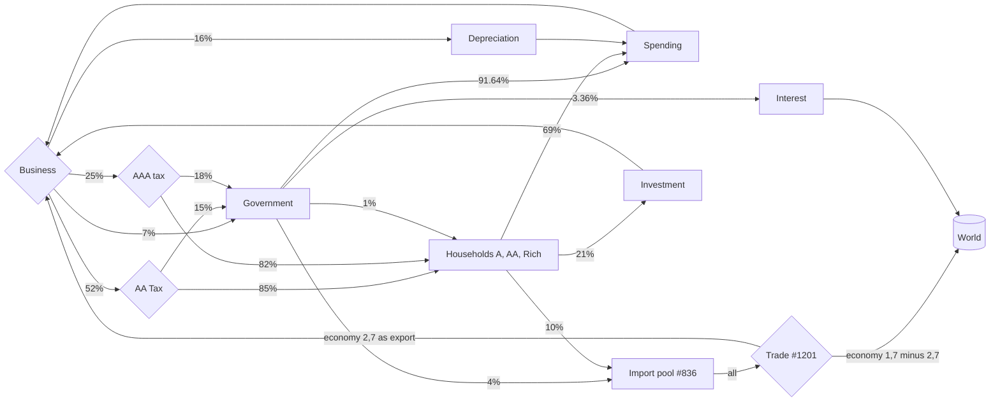

# Model entities and values

Source: saved diagram read on 2026-11-10 (first read, Play 676) plus the Play 677 fix. Element numbers are Machinations cell IDs. Percentages are from the copy of the Google Sheet stored with the diagram; the live sheet differs slightly (run started with 100 total money, stored copy sums to 94). The index order of `economy[row, column]` was not confirmed against the sheet.

## Overview

One resource, money. At the first read: 13 pools, 32 registers, 6 gates, 26 resource connections, 50 state connections. Plus the Play 677 additions: gate #1201, flow #1202.

## Two-step cycle

The diagram is designed as a cycle of two steps. On the first step money leaves the taxpayers (Households and Government) into Spending, Investment, the Import pool and Interest. On the second step Business pays it back out through the tax gates to Households and Government. Pools therefore swing every two steps by design. Compare values at the same phase, or as two-step averages. See [economy-model-review.md](economy-model-review.md).

## Vocabulary

- Pool: stores money.
- Gate: splits incoming money by ratio each step.
- Register: computed number shown or used by formulas (totals, shares).
- Resource connection: moves money (flow). Types seen: `all`, percentage, number.
- State connection: passes a value or overwrites a label/formula.
- Layer: visual grouping, can be hidden.

## Flow of money

## Pools

| Pool | Id | Role |
| --- | --- | --- |
| Households (A, AA, Rich) | n/a | Hold household money. Fell 83 to 1 in Play 676, to 4 in Play 677. |
| Government | #585 | Receives taxes and 7% of Business; spends 91.64%. |
| Spending | n/a | Household and Government spending, flows to Business. |
| Investment | #790 | 21% of household outflow; flows to Business. |
| Depreciation | n/a | 16% of Business outflow; flows back into Spending. |
| Import pool | #836 | Push-all. 4% of Government plus 10% of Households. Now feeds the Trade gate. |
| World (trade) | #642 | Pull pool. Receives the trade share. Never sends money out. |
| World (interest) | #947 | Push-all. Receives interest, no outflow (open). |
| Debt | #709 | Fixed at 95, no flows. |
| Interest | n/a | 3.36% of Government spending, flows to World. |
| Stock | #770 | Dead, connects to nothing. |

## Gates

| Gate | Id | Splits |
| --- | --- | --- |
| Business | #496 | 7% Government, 16% Depreciation, 52% AA tax, 25% AAA tax |
| AA Tax | n/a | 85% Households, 15% Government |
| AAA tax | n/a | 82% Households, 18% Government |
| Government spending | #1011 | 91.64% Spending, 1% Households, 4% Import pool, 3.36% Interest (outputs are % labels) |
| Trade | #1201 | Added in Play 677: deterministic, passive. Outputs #1064 (to Business, `economy[2,7]`) and #914 (to World, `economy[1,7]-economy[2,7]`). |

## Registers

32 registers, mainly in the TOTAL, Export/Import and World layers. Named ones:

| Register | Id | Notes |
| --- | --- | --- |
| Total | n/a | Sum check; subtracts export, which is not a pool (open). |
| GDP, BASE, LOSS | #891 (LOSS) | LOSS = interest + import - export. |
| IMPORT, EXPORT | #921 (EXPORT) | EXPORT derived from import (about 2/3). |
| export (world) | #640 | Reads World pool; label misleading. |
| #950 | | Depends on #640. |
| DEBT | #710 | Reads Debt pool. |
| abs(ie) | #1065 | Feeds nothing since Play 677. Input #1066. |
| Initial EXP | #1088 | Dead. |
| #895 | | Connected to Stock pool #770 via #897. Dead. |

## Layers

| Layer | Elements | Holds |
| --- | --- | --- |
| (unnamed default) | 46 | Government spending gate, start-value registers, Total, many flows. Unsorted. |
| Base | 27 | Household pools, Government pool, Business gate |
| Business | 18 | Tax gates, Spending and Investment pools |
| Stock | 8 | Depreciation pool, Stock pool, GDP links #795, #802 (belong in TOTAL) |
| Debt | 7 | Debt pool, Interest pool |
| Export/Import | 9 | Import pool, IMPORT and EXPORT registers |
| World | 10 | Two World pools and registers |
| TOTAL | 11 | GDP, BASE, LOSS summary registers |

## Run settings

60 steps, interval 5. Start total 100 money. DEBT 95 constant.

## Known typos in the diagram

`INTERES`, `DEPT`, `GOVER MENT`. Title and description are still the Willy Wonka tutorial, and the diagram is public.
